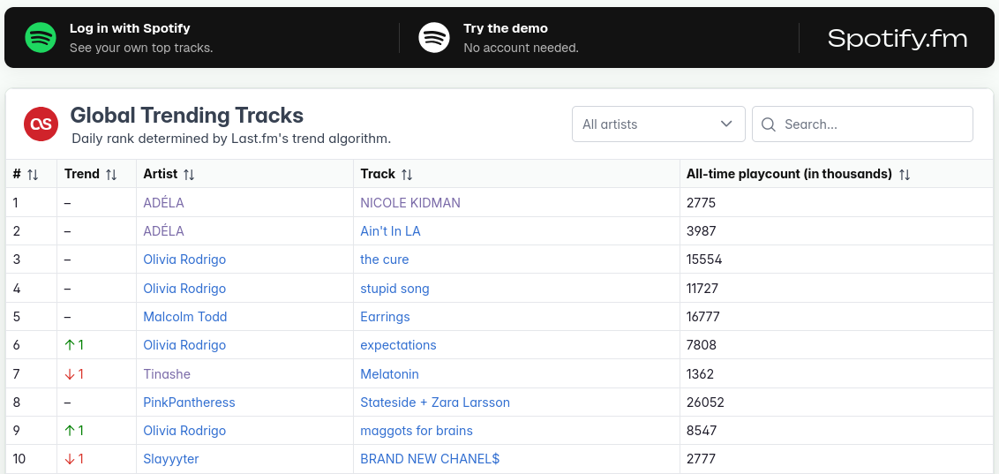
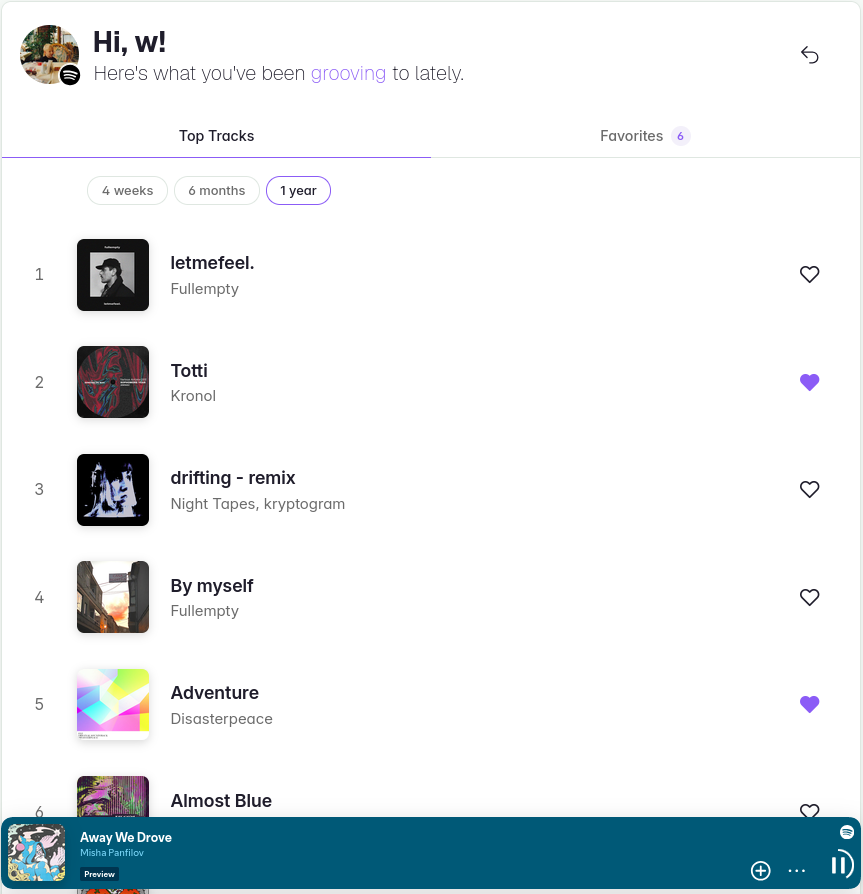

# Spotify.fm

Daily global trending tracks from Last.fm, as well as your personal top tracks from Spotify.

https://spotify-fm-next.onrender.com

### Global Trending Chart
- Last.fm's top 50 tracks, updated daily
- Trend column shows rank changes and new arrivals since yesterday
- All-time playcount for every track
- Filter by artist, search the table, or sort by any column

### Spotify Top Tracks
- Your most played tracks on Spotify for the last 4 weeks, 6 months and 1 year
- Play the tracks on the page using Spotify's embedded player
- Save favorites that persist between visits
- Note that Spotify only lets invited accounts log in to apps in development mode, so please send me your Spotify account email at weverhall@gmail.com to get access!

### Demo Top Tracks
- Access My Tracks page without Spotify login
- Shows mock data and favorites can't be stored

## Technical Overview

**Core:** Next.js (App Router), TypeScript, PrimeReact, Zod

**Storage:** MongoDB (via Atlas), Redis (via Render)

**Testing:** Vitest, MSW, Playwright

**Infrastructure:** Docker, GitHub Actions, Render

A GitHub Actions cron job fetches Last.fm's global trending tracks, stores them as a snapshot in MongoDB and triggers ISR revalidation of the homepage. Trends are calculated by comparing the snapshot of today vs. yesterday. Page loads never call the API, so users don't depend on its availability or rate limits.

Spotify login uses OAuth with a CSRF state param. Sessions are stored server-side in Redis and the browser only has an httpOnly cookie. My Tracks page calls Spotify API server-side with the user's token, fetching their profile and top tracks for all 3 time ranges in parallel.

Favorites are saved in MongoDB with Server Actions and optimistic UI updates.

## Rendering

| Page | Strategy | Rationale |
|---|---|---|
| Home | Static generation with ISR | Chart changes once a day, so the page is prebuilt and then regenerated after every snapshot |
| My Tracks | Server-side rendering | Data is specific to user's session, so the page is rendered on the server for each request |
| Demo | Static generation | Sample data doesn't change at all, so the page is fully created at build time |

Interactive parts (table's search, filter and sorting, the embedded player and favorites) use client-side rendering.

## Containers

In production, a multi-stage Dockerfile builds the app and runs it as a non-root user with production dependencies only, deployed on Render. Uses the node:24-alpine image, as it's lightweight and has a relatively low attack surface.

For development, Docker Compose runs the app with local MongoDB and Redis. Uses the Debian-based node:24-slim image for a better developer experience.
 
## Testing and CI/CD

Unit and integration tests (Vitest, Mock Service Worker): data fetching, chart logic, favorites actions

End-to-end tests (Playwright): search, filtering, auth redirects... e2e testing with real Spotify login was deemed to be out-of-scope for this project

Pushes to main run typecheck, linting, security scans and all tests, and on success deploys to Render

## Security

| Area | Measures |
|---|---|
| Validation | Runtime checks with Zod on client-sent data and API responses |
| Authentication | Spotify tokens kept server-side in Redis, OAuth state and SameSite cookies against CSRF, minimal `user-top-read` Spotify scope |
| Writes | Rate limiting and a per-user cap on favorites |
| Browser | Content Security Policy and security headers |
| Dependencies | Monthly Dependabot updates and npm audit |
| Scanning | CodeQL for code vulns, Trivy for dependency vulns, secrets and container misconfigs |

## Disclaimers

This is a university course project and there's no affiliation with Spotify or Last.fm.

Browser-based Sonnet 5 was used during development in 2026 to learn about implementation options and explain various concepts. The CSS code, database models and the hook for Spotify's embedded player are mostly AI generated and marked as such.
